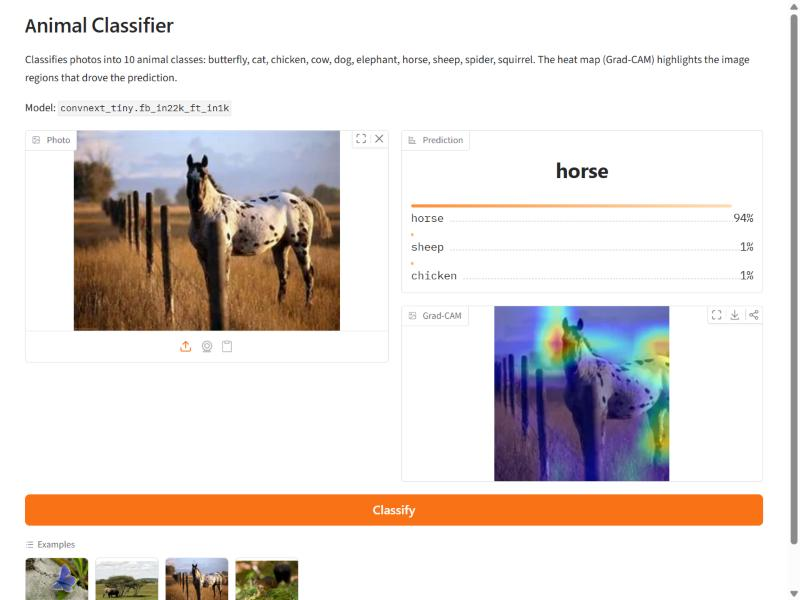
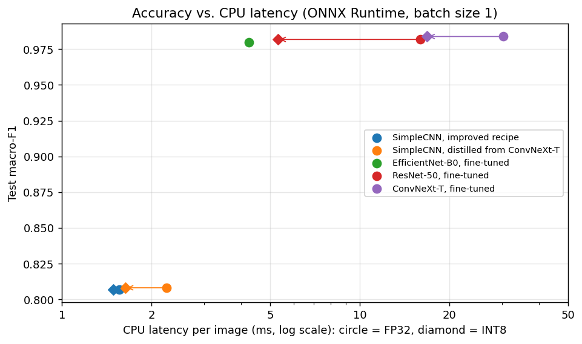
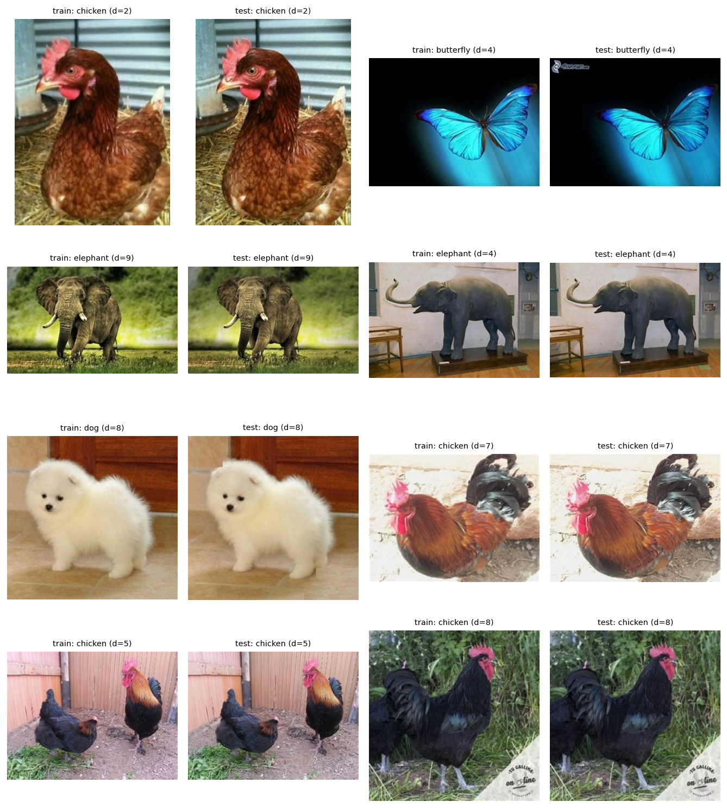
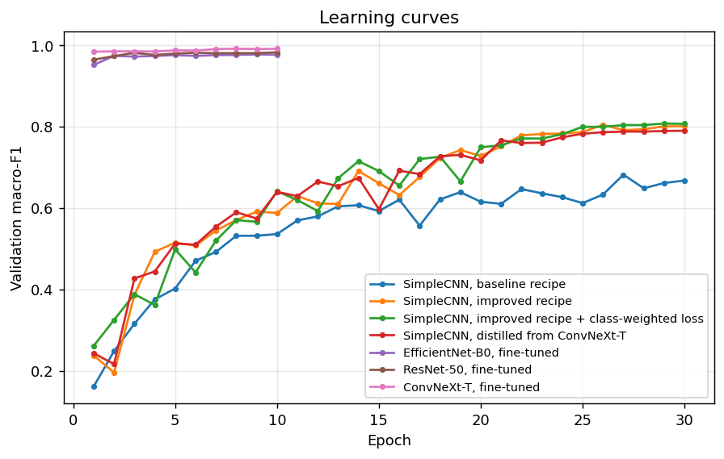
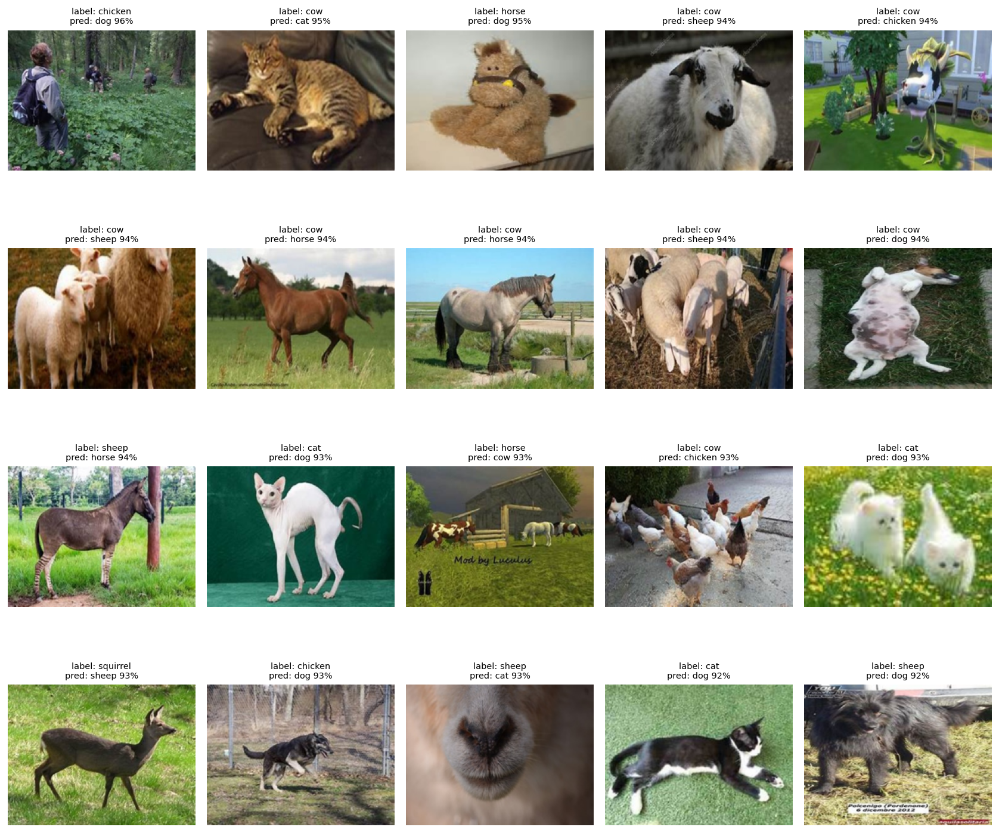
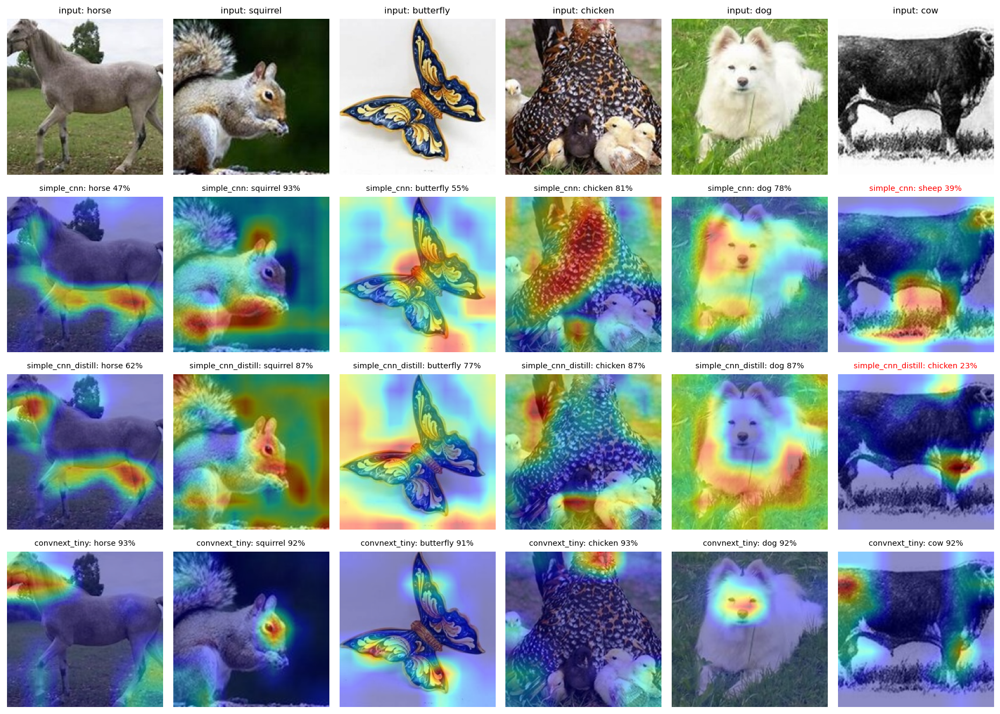

# Animal Classifier

[](https://github.com/VuTien1311/animal-image-classifier/actions/workflows/ci.yml)

**An end-to-end image-classification project, from a 70% from-scratch CNN to a 98.6% fine-tuned
ConvNeXt. It covers a data audit, controlled experiments, explainability and INT8 serving.**

Ten-class animal classification on [Animals-10](https://www.kaggle.com/datasets/alessiocorrado99/animals10)
(26,179 web images: butterfly, cat, chicken, cow, dog, elephant, horse, sheep, spider, squirrel).
The goal is not only a high score. It is to show the full workflow:
- check the data before trusting it;
- change one thing at a time and measure it on a validation split;
- report the test score once;
- explain the model's decisions;
- ship a model whose serving path is tested.



## Highlights

- **Data audit.** Calibrated perceptual hashing found **545 train images that are near-duplicates of
  test images** (train/test leakage). It also caught a loading pitfall that turns transparent PNGs
  into black images. Both are fixed in the data pipeline.
- **Controlled experiments.** A from-scratch CNN baseline went from **70.4% → 82.6%** test accuracy
  with a better training recipe alone. Fine-tuning a pretrained ConvNeXt-T reaches **98.6%**, and
  CLIP zero-shot reaches **99.1%** without a single training image.
- **Honest negative results.** Knowledge distillation and class-weighted loss gave no significant
  gain; the [findings](#findings) explain why.
- **Error analysis.** 13 of the 20 most confident test "errors" are mislabelled test images.
- **Deployment.**
  - ConvNeXt-T as INT8 ONNX is **4× smaller and 1.8× faster on CPU, with no accuracy loss**. The
    INT8 settings are chosen on the validation split, and EfficientNet-B0, which does not tolerate
    INT8, automatically stays FP32.
  - A FastAPI service in a Docker image, plus a Gradio demo with Grad-CAM.
  - 54 tests and CI.

## Results

Test split: 5,232 images, used once per model. Model selection, early stopping and quantisation
settings all use a separate validation split. Full tables: [results/RESULTS.md](results/RESULTS.md).

| Model | Pre-training | Params | Test accuracy | Macro-F1 | CPU latency\* |
|---|---|---:|---:|---:|---:|
| SimpleCNN, baseline recipe | none | 4.0M | 70.37% | 0.674 | |
| SimpleCNN, improved recipe | none | 4.0M | 82.61% | 0.807 | 1.5 ms |
| SimpleCNN, improved recipe + class-weighted loss | none | 4.0M | 82.42% | 0.810 | |
| SimpleCNN, distilled from ConvNeXt-T | none | 4.0M | 82.74% | 0.808 | 1.6 ms |
| EfficientNet-B0, fine-tuned | ImageNet-1k | 4.0M | 98.18% | 0.980 | 4.3 ms |
| ResNet-50, fine-tuned | ImageNet-1k | 23.5M | 98.32% | 0.982 | 5.3 ms |
| **ConvNeXt-T, fine-tuned** | ImageNet-22k | 27.8M | **98.57%** | **0.984** | 16.8 ms |
| CLIP ViT-L/14, zero-shot | 2B image–text pairs | 304M | 99.06% | 0.989 | |
| CLIP ViT-L/14, linear probe | 2B image–text pairs | 304M | 99.16% | 0.991 | |

\*Latency of the shipped ONNX model (INT8 where it was kept, otherwise FP32): one image, CPU only,
AMD Ryzen 7 8845HS, median of 200 runs.



## Pipeline

| Stage | Script | Output |
|---|---|---|
| 1. Data audit and split | `prepare_data.py`, `dedup_calibration.py` | `data/processed/`, `results/data/` |
| 2. Training | `train.py --config configs/<experiment>.yaml` | `outputs/<experiment>/` (checkpoints, logs, TensorBoard) |
| 3. Test evaluation | `evaluate.py`, `clip_eval.py` | `results/metrics/`, confusion matrices |
| 4. Deployment | `deploy.py` (ONNX export, INT8 chosen on val), `benchmark.py` (latency) | `models/`, `results/deployment/` |
| 5. Analysis | `gradcam_grid.py`, `error_analysis.py`, `make_report.py` | `results/figures/`, `results/error_analysis/`, `results/RESULTS.md` |

All scripts are in [`scripts/`](scripts/). `bash scripts/reproduce.sh <raw-data>` runs everything:
about 2.5 hours on one RTX 4060 Laptop GPU.

## Findings

### 1. The benchmark leaked

MD5 finds no duplicate files. Web-scraped datasets, though, contain the same photo resized,
re-encoded or watermarked. A difference hash (dHash) catches these copies.

To choose the hash and its threshold, I used the fact that genuine duplicates almost always share a
label. A train/test pair with *different* labels at a small distance is therefore a false match.
`dedup_calibration.py` counts, for every train image, the closest test image:

| 256-bit dHash distance | 0–15 | 16–27 | 28–31 | 32–39 | 40–47 |
|---|---:|---:|---:|---:|---:|
| Train images with a test image this close | 496 | 49 | 11 | 53 | 145 |
| … of which the two labels differ | 0% | 2% | 9% | 30% | 43% |

| 64-bit dHash distance | 0–2 | 3 | 4 | 5–7 |
|---|---:|---:|---:|---:|
| Train images with a test image this close | 496 | 61 | 67 | 507 |
| … of which the two labels differ | 0% | 15% | 25% | 57% |

A 64-bit hash starts confusing look-alikes at distance 3, typically unrelated objects on white
backgrounds. A 256-bit hash stays clean up to distance 27.

With a threshold of 28/256, the pipeline removes:
- **545 train images that duplicate test images**;
- **957 redundant copies inside train**, so a duplicate cannot land in both train and validation.

The test split itself is left unchanged.



### 2. Transparent PNGs turn into black images

`Image.open(path).convert("RGB")`, the usual way to load an image, drops the alpha channel. One of the
dataset's 49 transparent PNGs draws its butterfly only in the alpha channel, so a naive loader turns
it into an all-black image labelled "butterfly". Images are composited on white instead
(`preprocess.to_rgb`, with a regression test).

### 3. The training recipe is worth 12 points; pre-training is worth much more

The same SimpleCNN, trained for the same 30 epochs, went from **70.4% to 82.6%** test accuracy
(macro-F1 0.674 → 0.807). The changes were:
- augmentation and ImageNet normalisation;
- AdamW with a warm-up + cosine schedule;
- label smoothing.

EfficientNet-B0 has the **same number of parameters** (4.0M) and reaches **98.2%** after
fine-tuning. Pre-training and architecture matter far more than size here.



### 4. Distillation and class weighting: no significant gain

- **Knowledge distillation** from ConvNeXt-T sped up early training: val macro-F1 was 0.64 vs 0.59
  after 10 epochs. After 30 epochs the two runs ended level (82.7% vs 82.6% test accuracy, within
  single-seed noise). Two likely causes:
  - the student is the bottleneck: its convolutions have only 8–128 channels, and over 90% of its
    weights are in the MLP head;
  - the teacher was trained with label smoothing, which removes the inter-class similarity that
    distillation transfers ([Müller et al., 2019](https://arxiv.org/abs/1906.02629)).
- **Class-weighted loss** (weights ∝ 1/√frequency) behaved as expected: cat recall rose by 3.9
  points and sheep by 3.0, while recall on dog, the largest class, fell by 4.0. Net macro-F1 changed
  by only +0.003. The 3.6× imbalance is mild, so weighting stays off by default.

### 5. CLIP without training beats fine-tuned CNNs

CLIP ViT-L/14 with Apple's DFN-2B weights reaches:
- **99.06%** zero-shot, from 8 prompt templates per class and no training images;
- **99.16%** with a logistic-regression probe on frozen features.

Caveat: CLIP was pre-trained on 2 billion web image–text pairs and may have seen some of these web
images, so treat its scores as an upper bound.

A detail that mattered: these weights need the `ViT-L-14-quickgelu` architecture. Loading them as
plain `ViT-L-14` only prints a warning and silently costs accuracy.

### 6. The remaining errors are mostly label noise

I inspected the 20 test mistakes that ConvNeXt-T makes with the highest confidence
([audit](results/error_analysis/label_audit.md)):

| Verdict | Count | Examples |
|---|---:|---|
| Mislabelled test image | 13 | cats, sheep, horses and dogs in the `cow` folder |
| Real model error | 4 | e.g. a hairless cat predicted as a dog |
| Ambiguous | 3 | plush toy, game render, extreme close-up |

The reported accuracy is therefore a slight underestimate.



### 7. Quantisation is not free

Post-training INT8 quantisation behaves very differently per architecture. `deploy.py` tries four
calibration settings, keeps the best one on the validation split, and ships INT8 only if it costs at
most 1 point:

| Model | Best INT8 setting (chosen on val) | Test accuracy FP32 → INT8 | CPU latency FP32 → INT8 | Size |
|---|---|---:|---:|---:|
| ConvNeXt-T | Conv/MatMul only, min/max | 98.59% → 98.59% | 30.3 → 16.8 ms (1.8×) | 107 → 27 MB |
| ResNet-50 | all ops, min/max | 98.38% → 98.15% | 16.0 → 5.3 ms (3.0×) | 90 → 23 MB |
| EfficientNet-B0 | all ops, moving average | not shipped: −4.1 points on val | 4.3 ms (FP32 only) | 16 MB |

With ONNX Runtime's default settings, EfficientNet-B0 collapsed from 98% to 70% on val. Its depthwise
convolutions and squeeze-and-excitation layers are hard to quantise after training. Moving-average
calibration recovers most of the loss, but not enough to ship. The full study is in
[RESULTS.md](results/RESULTS.md).

Latency is measured separately by `benchmark.py`, all models in one session. Measured right after
the quantisation work, the laptop CPU was thermally throttled and the same model ran up to 2×
slower.

### Explainability

Grad-CAM heat maps on six random test images (fixed seed, not cherry-picked). ConvNeXt-T looks at
heads and faces. SimpleCNN's maps are diffuse and often land on the body or the background.



## Quick start

Requires Python ≥ 3.10. A GPU is needed only for training.

```bash
git clone https://github.com/VuTien1311/animal-image-classifier.git && cd animal-image-classifier
python -m venv .venv && source .venv/bin/activate        # Windows: .venv\Scripts\activate
pip install torch torchvision --index-url https://download.pytorch.org/whl/cu128   # or .../whl/cpu
pip install -e ".[train,serve,demo,clip,dev]"
```

**Data.** Download Animals-10 and arrange it as `<raw>/{train,test}/<class>/*.jpg` with the English
class names listed above. The split used here has 20,947 train and 5,232 test images.

```bash
python scripts/prepare_data.py --src <raw> --out data/processed
python scripts/train.py --config configs/convnext_tiny.yaml       # ~12 min on an RTX 4060 Laptop
python scripts/evaluate.py --checkpoint outputs/convnext_tiny/best.pt
python scripts/deploy.py --checkpoint outputs/convnext_tiny/best.pt

uvicorn app.api:app --port 8000                                   # REST API (ONNX Runtime)
curl -F "file=@cat.jpg" "http://localhost:8000/predict?top_k=3"
python app/gradio_app.py --checkpoint outputs/convnext_tiny/best.pt  # web demo with Grad-CAM
docker build -t animal-classifier . && docker run -p 8000:8000 animal-classifier
```

Any config value can be overridden from the command line, e.g.
`python scripts/train.py --config configs/simple_cnn.yaml --set train.epochs=5 data.batch_size=64`.

**Optional: host the demo on Hugging Face Spaces.**

```bash
python scripts/build_hf_space.py --checkpoint outputs/convnext_tiny/best.pt   # -> dist/hf_space/
hf auth login
hf repos create <user>/animal-classifier --type space --sdk gradio
hf upload <user>/animal-classifier dist/hf_space . --type space
```

## Project structure

```
animal-image-classifier/
├── configs/                  one YAML file per experiment
├── src/animal_classifier/    the library
│   ├── config.py             typed configuration (YAML + command-line overrides)
│   ├── preprocess.py         image preprocessing shared by evaluation and serving (no PyTorch)
│   ├── data.py               datasets, augmentation, stratified split
│   ├── data_quality.py       perceptual hashing, blank-image check
│   ├── models.py             SimpleCNN baseline + any timm model
│   ├── losses.py             knowledge-distillation loss
│   ├── engine.py             one training epoch / one evaluation pass
│   ├── trainer.py            training loop, checkpoints, early stopping, logging
│   ├── metrics.py            accuracy, macro-F1, per-class metrics
│   ├── gradcam.py            Grad-CAM
│   ├── export.py             ONNX export, INT8 quantisation, ONNX evaluation
│   ├── predictor.py          inference with ONNX Runtime or PyTorch
│   ├── benchmark.py          latency measurement
│   └── viz.py, utils.py      plotting, seeding, logging, JSON helpers
├── scripts/                  pipeline steps (see the table above) + reproduce.sh
├── app/                      api.py (FastAPI) and gradio_app.py (demo)
├── tests/                    unit and integration tests (CPU, synthetic data)
├── results/                  metrics, figures and reports (committed)
└── Dockerfile, pyproject.toml, .github/workflows/ci.yml
```

`data/`, `outputs/` (checkpoints) and `models/` (ONNX files) are generated and not committed.

## Pitfalls this project guards against

| Pitfall | How it is handled |
|---|---|
| Choosing the checkpoint on the test set | Stratified validation split for every choice; test used once per model |
| Near-duplicate images across train and test | Calibrated perceptual-hash deduplication |
| `convert("RGB")` on transparent PNGs | Alpha composited on white |
| Different preprocessing in training and serving (train/serve skew) | One preprocessing function, tested against torchvision |
| Accuracy hiding weak classes | Macro-F1, balanced accuracy, per-class metrics, confusion matrices |
| Shipping a quantised model without re-checking it | INT8 kept only if it costs ≤ 1 point on validation |
| Benchmarking on a throttled CPU | Latency measured separately, all models in one session |

## Tests and CI

```bash
pytest          # 54 tests, ~20 s on a CPU, no dataset or downloads needed
ruff check . && ruff format --check .
```

The tests use synthetic images and cover:
- config parsing;
- preprocessing equivalence with torchvision, and the transparency fix;
- stratified splitting, duplicate detection, losses and Grad-CAM;
- an end-to-end training run with resume;
- ONNX export and INT8 quantisation;
- latency measurement;
- the REST API, including its error cases.

[GitHub Actions](.github/workflows/ci.yml) runs lint and tests. It then builds the Docker image and
sends a request to the running container.

## Limitations

- The model always answers with one of the 10 classes, even for images with no animal. There is no
  out-of-distribution rejection.
- Each configuration was trained with a single seed. Differences of a few tenths of a point between
  the fine-tuned models are within noise.
- Test labels are noisy (see finding 6), so accuracies near 99% are imprecise.
- Latencies come from one laptop and vary by roughly ±20% between sessions.

## Acknowledgements

Dataset: [Animals-10](https://www.kaggle.com/datasets/alessiocorrado99/animals10) by Alessio Corrado.
Pretrained weights from [timm](https://github.com/huggingface/pytorch-image-models) and
[open_clip](https://github.com/mlfoundations/open_clip) (Apple DFN-2B CLIP).
